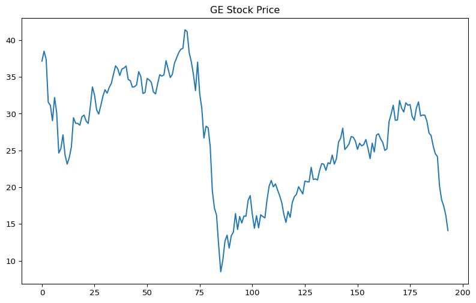
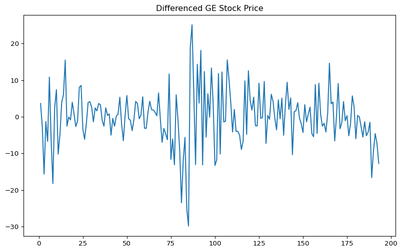
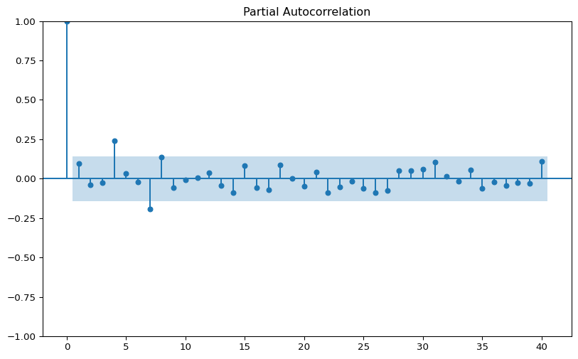
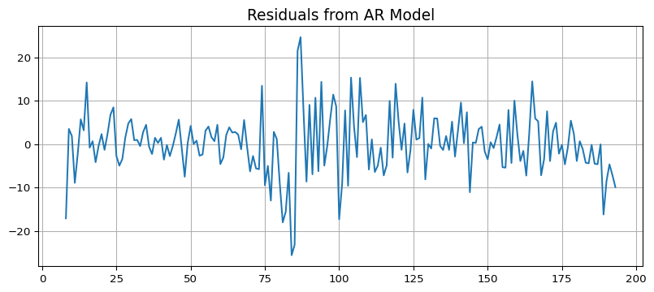
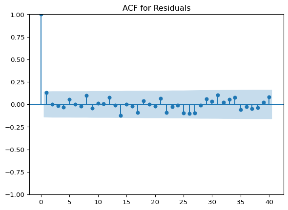
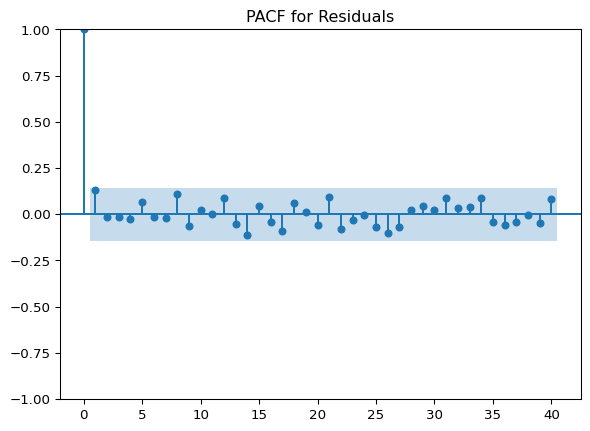
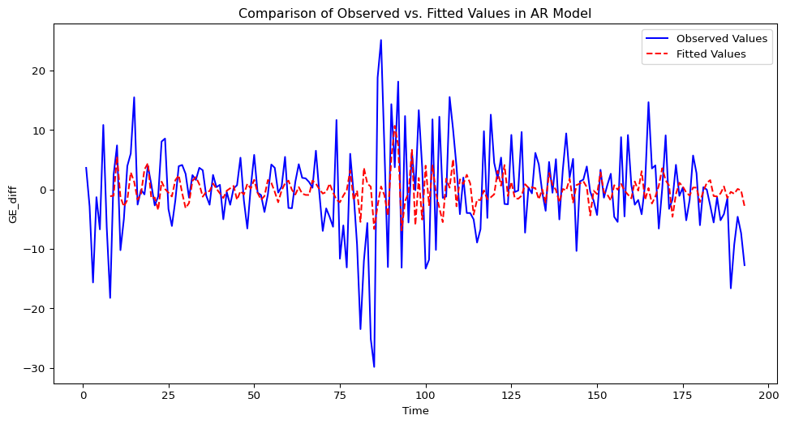

# Estimating Autoregressive (AR) Models

To estimate an Autoregressive (AR) model for the General Electric (GE)
stock price, we can use the statsmodels library in Python. The steps to
do so include loading the data, visualizing it, performing stationarity
tests, determining the order of the AR model, and finally estimating the
model. Below is a step-by-step guide and Python code to accomplish this
task.

## Step 1: Import Libraries and Load Data

First, we need to import necessary libraries and load the data from the
CSV file.

``` python
import pandas as pd
import numpy as np
import matplotlib.pyplot as plt
from statsmodels.tsa.stattools import adfuller, acf, pacf
from statsmodels.tsa.ar_model import AutoReg
from statsmodels.graphics.tsaplots import plot_pacf, plot_acf

# Load the dataset
df = pd.read_csv('data/capm.csv')
df.head()
```

|     | Date   | SANDP       | FORD  | GE        | MICROSOFT | ORACLE    | USTB3M |
|-----|--------|-------------|-------|-----------|-----------|-----------|--------|
| 0   | Jan-02 | 1130.199951 | 15.30 | 37.150002 | 31.855000 | 17.260000 | 1.68   |
| 1   | Feb-02 | 1106.729980 | 14.88 | 38.500000 | 29.170000 | 16.620001 | 1.76   |
| 2   | Mar-02 | 1147.390015 | 16.49 | 37.400002 | 30.155001 | 12.800000 | 1.83   |
| 3   | Apr-02 | 1076.920044 | 16.00 | 31.549999 | 26.129999 | 10.040000 | 1.75   |
| 4   | May-02 | 1067.140015 | 17.65 | 31.139999 | 25.455000 | 7.920000  | 1.76   |


## Step 2: Visualize the Data

Visualizing the GE stock price to understand its behavior over time.

``` python
df['GE'].plot(title='GE Stock Price', figsize=(10, 6))
plt.show()
```



## Step 3: Test for Stationarity

Before estimating an AR model, we need to ensure that the time series is
stationary. We use the Augmented Dickey-Fuller (ADF) test for this
purpose.

``` python
result_adf = adfuller(df['GE'], autolag='AIC')
print(f'ADF Statistic: {result_adf[0]}')
print(f'p-value: {result_adf[1]}')
```

    ADF Statistic: -1.8355727211649135
    p-value: 0.36294924697873976

> [!note]
> The null hypothesis of the ADF test is that the series has a unit root
> (it is not stationary). If the p-value is greater than 0.05, we cannot
> reject it: we treat the series as non-stationary, difference it and
> test again.

Here the p-value is 0.36, so we treat the GE price as non-stationary,
difference the series and test again.

> [!important]
> We use GE’s monthly return in percent, `pct_change() * 100`, which is a
> relative (percentage) first difference: calculating the percentage
> change of a series also implies differencing the series. We keep the
> column name `GE_diff` for it. This monthly return is not annualised and
> no risk-free rate is subtracted, because here we model GE’s own
> returns, not excess returns.

``` python
# Alternative: the first difference in dollars
# df['GE_diff'] = df['GE'].diff()

# GE's monthly return in percent (a percentage first difference)
df["GE_diff"] = df["GE"].pct_change() * 100

# Drop the NaN value created by differencing and renumber the rows from 0
df = df.dropna().reset_index(drop=True)

result_adf = adfuller(df['GE_diff'], autolag='AIC')
print(f'ADF Statistic: {result_adf[0]}')
print(f'p-value: {result_adf[1]}')
```

    ADF Statistic: -4.051148422228882
    p-value: 0.001165136499938297

> [!note]
> Testing again (p-value 0.001 < 0.05), we reject the null hypothesis of
> a unit root. Therefore, GE’s returns (the differenced series) are
> stationary.

Let’s visualize the new differenced series:

``` python
df['GE_diff'].plot(title='Differenced GE Stock Price', figsize=(10, 6))
plt.show()
```



As we can see, the series seems to move randomly around a constant mean,
which is indicative of stationarity.

## Step 4: Determine the Order of the AR Model

We use the Partial Autocorrelation Function (PACF) to help determine the
order of the AR model.

``` python
# Plot PACF
fig, ax = plt.subplots(figsize=(10, 6))
plot_pacf(df['GE_diff'], lags=40, ax=ax)
plt.show()
```



> [!note]
> The lags whose bars cross the confidence band (the shaded area) are an
> indication of the order of the AR model. In this case, the 4th and 7th
> lags seem to be significant, and perhaps the 8th as well.

## Step 5: Estimate the AR Model

After determining the order, we can estimate the AR model using the
AutoReg function from statsmodels.

> [!note]
> Based on the previous PACF, it seems like lags 4, 7, and maybe 8, are
> significant.

Let’s first add all lags up to the 8th to test for significance:

``` python
model = AutoReg(df['GE_diff'], lags=8)
model_fitted = model.fit()

print(model_fitted.summary())
```

                                AutoReg Model Results                             
    ==============================================================================
    Dep. Variable:                GE_diff   No. Observations:                  185
    Model:                     AutoReg(8)   Log Likelihood                -620.415
    Method:               Conditional MLE   S.D. of innovations              6.922
    Date:                Sun, 12 May 2024   AIC                           1260.830
    Time:                        07:55:36   BIC                           1293.033
    Sample:                             8   HQIC                          1273.881
                                      193                                         
    ==============================================================================
                     coef    std err          z      P>|z|      [0.025      0.975]
    ------------------------------------------------------------------------------
    const         -0.0268      0.509     -0.053      0.958      -1.025       0.971
    GE_diff.L1     0.1317      0.072      1.828      0.068      -0.010       0.273
    GE_diff.L2    -0.0023      0.071     -0.032      0.974      -0.142       0.137
    GE_diff.L3    -0.0087      0.071     -0.123      0.902      -0.147       0.130
    GE_diff.L4     0.1974      0.070      2.801      0.005       0.059       0.335
    GE_diff.L5     0.0098      0.071      0.138      0.890      -0.130       0.150
    GE_diff.L6    -0.0049      0.071     -0.069      0.945      -0.144       0.134
    GE_diff.L7    -0.2029      0.071     -2.870      0.004      -0.341      -0.064
    GE_diff.L8     0.1430      0.072      1.985      0.047       0.002       0.284
                                        Roots                                    
    =============================================================================
                      Real          Imaginary           Modulus         Frequency
    -----------------------------------------------------------------------------
    AR.1           -1.1282           -0.0000j            1.1282           -0.5000
    AR.2           -0.8106           -0.9414j            1.2423           -0.3631
    AR.3           -0.8106           +0.9414j            1.2423            0.3631
    AR.4            0.1402           -1.1410j            1.1495           -0.2305
    AR.5            0.1402           +1.1410j            1.1495            0.2305
    AR.6            1.2314           -0.7850j            1.4604           -0.0903
    AR.7            1.2314           +0.7850j            1.4604            0.0903
    AR.8            1.4253           -0.0000j            1.4253           -0.0000
    -----------------------------------------------------------------------------


At the 5% level, lags 4, 7 and 8 are significant (p-values 0.005, 0.004
and 0.047). At the 10% level, lag 1 is significant as well (p-value
0.068). Let’s estimate again with only the lags that are significant at
5%:

``` python
model = AutoReg(df['GE_diff'], lags=[4, 7, 8])
model_fitted = model.fit()

print(model_fitted.summary())
```

                                AutoReg Model Results                             
    ==============================================================================
    Dep. Variable:                GE_diff   No. Observations:                  185
    Model:              Restr. AutoReg(8)   Log Likelihood                -622.239
    Method:               Conditional MLE   S.D. of innovations              6.990
    Date:                Mon, 02 Nov 2026   AIC                           1254.478
    Time:                        08:38:35   BIC                           1270.580
    Sample:                             8   HQIC                          1261.004
                                      193                                         
    ==============================================================================
                     coef    std err          z      P>|z|      [0.025      0.975]
    ------------------------------------------------------------------------------
    const         -0.0287      0.514     -0.056      0.955      -1.036       0.979
    GE_diff.L4     0.1998      0.071      2.831      0.005       0.061       0.338
    GE_diff.L7    -0.2071      0.069     -2.993      0.003      -0.343      -0.071
    GE_diff.L8     0.1121      0.071      1.583      0.113      -0.027       0.251
                                        Roots                                    
    =============================================================================
                      Real          Imaginary           Modulus         Frequency
    -----------------------------------------------------------------------------
    AR.1           -1.1115           -0.0000j            1.1115           -0.5000
    AR.2           -0.8093           -0.9459j            1.2448           -0.3626
    AR.3           -0.8093           +0.9459j            1.2448            0.3626
    AR.4            0.1249           -1.1593j            1.1660           -0.2329
    AR.5            0.1249           +1.1593j            1.1660            0.2329
    AR.6            1.3131           -0.7174j            1.4963           -0.0796
    AR.7            1.3131           +0.7174j            1.4963            0.0796
    AR.8            1.7024           -0.0000j            1.7024           -0.0000
    -----------------------------------------------------------------------------

> [!important]
> Once the insignificant lags are dropped, lag 8 is no longer significant
> (p-value 0.113 > 0.05), so we drop it too and keep only lags 4 and 7
> (which is congruent with the PACF plot above). A p-value can change when
> other lags are removed, so drop lags step by step and estimate again
> each time.

``` python
model = AutoReg(df['GE_diff'], lags=[4, 7])
model_fitted = model.fit()

print(model_fitted.summary())
```

                                AutoReg Model Results                             
    ==============================================================================
    Dep. Variable:                GE_diff   No. Observations:                  186
    Model:              Restr. AutoReg(7)   Log Likelihood                -629.293
    Method:               Conditional MLE   S.D. of innovations              7.130
    Date:                Sun, 12 May 2024   AIC                           1266.586
    Time:                        07:55:36   BIC                           1279.489
    Sample:                             7   HQIC                          1271.814
                                      193                                         
    ==============================================================================
                     coef    std err          z      P>|z|      [0.025      0.975]
    ------------------------------------------------------------------------------
    const         -0.1099      0.523     -0.210      0.834      -1.135       0.915
    GE_diff.L4     0.2263      0.070      3.224      0.001       0.089       0.364
    GE_diff.L7    -0.2038      0.070     -2.899      0.004      -0.342      -0.066
                                        Roots                                    
    =============================================================================
                      Real          Imaginary           Modulus         Frequency
    -----------------------------------------------------------------------------
    AR.1            1.1891           -0.4590j            1.2746           -0.0586
    AR.2            1.1891           +0.4590j            1.2746            0.0586
    AR.3            0.1961           -1.1760j            1.1923           -0.2237
    AR.4            0.1961           +1.1760j            1.1923            0.2237
    AR.5           -1.1629           -0.0000j            1.1629           -0.5000
    AR.6           -0.8038           -1.0867j            1.3517           -0.3514
    AR.7           -0.8038           +1.0867j            1.3517            0.3514
    -----------------------------------------------------------------------------

> [!tip]
> **Your turn:** analyze the results using the p-values of the
> significance tests and decide which lags are significant.

Let’s analyze the residuals from this last estimation:

``` python
# Plot residuals
residuals = model_fitted.resid
plt.figure(figsize=(10, 4))
plt.plot(residuals)
plt.title('Residuals from AR Model', fontsize=14)
plt.grid(True)
plt.show()

plot_acf(residuals, lags=40, title='ACF for Residuals')
plt.show()

plot_pacf(residuals, lags=40, title='PACF for Residuals')
plt.show()

# Run the Ljung-Box Test. The null hypothesis is no autocorrelation in the residuals.
# A significant result (p < 0.05) suggests there is autocorrelation left, which is undesirable.
# model_df=2 is the number of AR coefficients we estimated (lags 4 and 7);
# it reduces the degrees of freedom of the test.

from statsmodels.stats.diagnostic import acorr_ljungbox

print(acorr_ljungbox(residuals, lags=[10], model_df=2))
```







         lb_stat  lb_pvalue
    10  6.378516   0.604912

> [!important]
> In the ACF and PACF plots of the residuals, no lag is outside the
> confidence band (ignore lag 0, which is always 1; lag 1 is close to the
> edge but inside), so the AR model seems to capture the autocorrelation
> of the returns.
>
> The Ljung-Box test agrees: it does not reject the null hypothesis of no
> autocorrelation (p-value 0.60 > 0.05), so we find no statistically
> significant evidence of autocorrelation in the residuals up to lag 10.

## Step 6: Forecasting

Finally, let’s do some forecasting for the next 5 periods after the last
available observation:

``` python
# Replace steps with the number of future steps you want to predict
forecast = model_fitted.forecast(steps=5)
print(forecast)
```

    193   -1.365660
    194   -0.842158
    195    1.618217
    196   -1.102726
    197    0.517009
    dtype: float64

> [!note]
> These are forecasts of GE’s monthly returns in percent, not of its
> price. For example, the model forecasts a return of −1.37% for the
> first month after the data ends.


We can also compare in a plot the observed vs the fitted or forecasted
values:

``` python
fitted_values = model_fitted.fittedvalues

plt.figure(figsize=(12, 6))
plt.plot(df['GE_diff'], label='Observed Values', color='blue')
plt.plot(fitted_values, label='Fitted Values', color='red', linestyle='--')
plt.title('Comparison of Observed vs. Fitted Values in AR Model')
plt.xlabel('Time')
plt.ylabel('GE_diff')
plt.legend()
plt.show()
```


