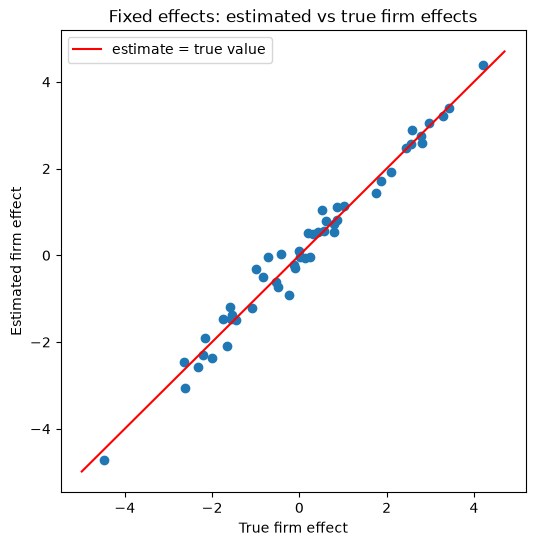

# Panel Data Models

We are going to use the AIRFARE data set from Wooldridge’s Introductory
Econometrics which contains data on airline flights, used to study the
factors affecting airfare pricing.

This data set contains the following variables:

- `year`: 1997, 1998, 1999, 2000
- `origin`: flight’s origin
- `destin`: flight’s destination
- `id`: route identifier
- `dist`: distance, in miles
- `passen`: avg. passengers per day
- `fare`: avg. one-way fare, in \$
- `bmktshr`: fraction market, biggest carrier
- `ldist`: log(distance)
- `y98`: =1 if year == 1998
- `y99`: =1 if year == 1999
- `y00`: =1 if year == 2000
- `lfare`: log(fare)
- `ldistsq`: ldist^2
- `concen`: = bmktshr
- `lpassen`: log(passen)

## Import libraries and summarize data

We will be using the `linearmodels` library to estimate panel data
models:

``` python
import numpy as np
import pandas as pd
import scipy.stats as stats
import matplotlib.pyplot as plt
import statsmodels.formula.api as smf
from linearmodels.panel import PooledOLS, PanelOLS, RandomEffects, BetweenOLS, compare
```

Let’s import and take a look at the data:

``` python
data = pd.read_csv('data/airfare.csv')

# Set the index for both individuals and time
data = data.set_index(['id', 'year'])

print(data.head())
print(data.describe())
```

                  origin         destin  dist  ...   ldistsq  concen   lpassen
    id year                                    ...                            
    1  1997  "AKRON, OH"  "ATLANTA, GA"   528  ...  39.30157  0.8386  5.023880
       1998  "AKRON, OH"  "ATLANTA, GA"   528  ...  39.30157  0.8133  5.579730
       1999  "AKRON, OH"  "ATLANTA, GA"   528  ...  39.30157  0.8262  5.817111
       2000  "AKRON, OH"  "ATLANTA, GA"   528  ...  39.30157  0.8612  5.697093
    2  1997  "AKRON, OH"  "ORLANDO, FL"   861  ...  45.67184  0.5798  5.641907

    [5 rows x 14 columns]
                  dist       passen  ...       concen      lpassen
    count  4596.000000  4596.000000  ...  4596.000000  4596.000000
    mean    989.744996   636.824195  ...     0.610115     6.017027
    std     611.831506   811.999966  ...     0.196435     0.883987
    min      95.000000     2.000000  ...     0.160500     0.693147
    25%     505.000000   215.000000  ...     0.465000     5.370638
    50%     861.000000   357.000000  ...     0.603950     5.877736
    75%    1304.000000   717.000000  ...     0.753100     6.575076
    max    2724.000000  8497.000000  ...     1.000000     9.047468

    [8 rows x 12 columns]

The data set has 1,149 routes, each observed in 4 years (1997 to 2000),
so 4,596 rows in total.

## The model

We explain the (log) fare on route $i$ in year $t$:

$$
lfare_{it} = \beta_0 + \beta_1 ldist_{i} + \beta_2 ldistsq_{i} + \beta_3 lpassen_{it} + \beta_4 bmktshr_{it} + a_i + u_{it}
$$

> [!note]
> $a_i$ is the **route effect**: everything about route $i$ that does not
> change over time and is not in the data (airport fees, the share of
> business travelers, how hard it is for a new airline to enter, …).

> [!important]
> The models differ in how they treat $a_i$:
>
> - **Pooled OLS** ignores it: $a_i$ stays in the error term. It is
>   biased if $a_i$ is correlated with the regressors.
> - **Fixed effects** removes it, by comparing each route with itself
>   over time (it subtracts the route’s average from every variable). It
>   is consistent even if $a_i$ is correlated with the regressors.
> - **Random effects** assumes $a_i$ is uncorrelated with the regressors
>   and subtracts only part of each route’s average. If that assumption
>   holds, it is more efficient than fixed effects.
> - The **between estimator**, which we add only for comparison, uses
>   just the route averages, so $a_i$ stays in its error term, as in
>   pooled OLS.

## Estimate Pooled OLS

**Model in levels**

``` python
pooled_ols = PooledOLS.from_formula('fare ~ 1 + dist + passen + bmktshr', data=data)
pooled_results = pooled_ols.fit()
print(pooled_results)
```

                              PooledOLS Estimation Summary                          
    ================================================================================
    Dep. Variable:                   fare   R-squared:                        0.4183
    Estimator:                  PooledOLS   R-squared (Between):              0.4440
    No. Observations:                4596   R-squared (Within):              -0.0154
    Date:                Mon, Nov 02 2026   R-squared (Overall):              0.4183
    Time:                        08:47:34   Log-likelihood                -2.511e+04
    Cov. Estimator:            Unadjusted                                           
                                            F-statistic:                      1100.7
    Entities:                        1149   P-value                           0.0000
    Avg Obs:                       4.0000   Distribution:                  F(3,4592)
    Min Obs:                       4.0000                                           
    Max Obs:                       4.0000   F-statistic (robust):             1100.7
                                            P-value                           0.0000
    Time periods:                       4   Distribution:                  F(3,4592)
    Avg Obs:                       1149.0                                           
    Min Obs:                       1149.0                                           
    Max Obs:                       1149.0                                           

                                 Parameter Estimates                              
    ==============================================================================
                Parameter  Std. Err.     T-stat    P-value    Lower CI    Upper CI
    ------------------------------------------------------------------------------
    Intercept      52.995     4.4881     11.808     0.0000      44.197      61.794
    dist           0.0875     0.0016     53.177     0.0000      0.0843      0.0907
    passen        -0.0049     0.0011    -4.6770     0.0000     -0.0070     -0.0029
    bmktshr        69.431     5.1225     13.554     0.0000      59.388      79.473
    ==============================================================================

**Model in logs**

``` python
pooled_ols = PooledOLS.from_formula('lfare ~ 1 + ldist + ldistsq + lpassen + bmktshr', data=data)
pooled_results = pooled_ols.fit()
print(pooled_results)
```

                              PooledOLS Estimation Summary                          
    ================================================================================
    Dep. Variable:                  lfare   R-squared:                        0.4227
    Estimator:                  PooledOLS   R-squared (Between):              0.4396
    No. Observations:                4596   R-squared (Within):               0.1117
    Date:                Mon, Nov 02 2026   R-squared (Overall):              0.4227
    Time:                        08:47:34   Log-likelihood                   -1447.6
    Cov. Estimator:            Unadjusted                                           
                                            F-statistic:                      840.30
    Entities:                        1149   P-value                           0.0000
    Avg Obs:                       4.0000   Distribution:                  F(4,4591)
    Min Obs:                       4.0000                                           
    Max Obs:                       4.0000   F-statistic (robust):             840.30
                                            P-value                           0.0000
    Time periods:                       4   Distribution:                  F(4,4591)
    Avg Obs:                       1149.0                                           
    Min Obs:                       1149.0                                           
    Max Obs:                       1149.0                                           

                                 Parameter Estimates                              
    ==============================================================================
                Parameter  Std. Err.     T-stat    P-value    Lower CI    Upper CI
    ------------------------------------------------------------------------------
    Intercept      7.0392     0.4185     16.819     0.0000      6.2187      7.8597
    ldist         -0.9683     0.1266    -7.6515     0.0000     -1.2164     -0.7202
    ldistsq        0.1065     0.0096     11.101     0.0000      0.0877      0.1253
    lpassen       -0.0773     0.0056    -13.745     0.0000     -0.0883     -0.0662
    bmktshr        0.3028     0.0298     10.150     0.0000      0.2443      0.3613
    ==============================================================================

From here on we use the model in logs.

## Estimate fixed effects model

In `linearmodels`, the fixed effects model is `PanelOLS` with
`EntityEffects` in the formula (one effect $a_i$ for each route, the
“entity”).

> [!important]
> **Fixed effects cannot estimate the effect of a variable that does not
> change over time.** `ldist` and `ldistsq` never change within a route
> (the distance between two cities is always the same), so the route
> effects absorb them. `drop_absorbed=True` drops those variables (with a
> warning) instead of stopping with an error.

``` python
fixed_effects = PanelOLS.from_formula('lfare ~ 1 + ldist + ldistsq + lpassen + bmktshr + EntityEffects',
                                      data=data, drop_absorbed=True)
fe_results = fixed_effects.fit()
print(fe_results)
```

                              PanelOLS Estimation Summary                           
    ================================================================================
    Dep. Variable:                  lfare   R-squared:                        0.2864
    Estimator:                   PanelOLS   R-squared (Between):             -0.1484
    No. Observations:                4596   R-squared (Within):               0.2864
    Date:                Mon, Nov 02 2026   R-squared (Overall):             -0.1260
    Time:                        08:47:34   Log-likelihood                    4876.6
    Cov. Estimator:            Unadjusted                                           
                                            F-statistic:                      691.32
    Entities:                        1149   P-value                           0.0000
    Avg Obs:                       4.0000   Distribution:                  F(2,3445)
    Min Obs:                       4.0000                                           
    Max Obs:                       4.0000   F-statistic (robust):             691.32
                                            P-value                           0.0000
    Time periods:                       4   Distribution:                  F(2,3445)
    Avg Obs:                       1149.0                                           
    Min Obs:                       1149.0                                           
    Max Obs:                       1149.0                                           

                                 Parameter Estimates                              
    ==============================================================================
                Parameter  Std. Err.     T-stat    P-value    Lower CI    Upper CI
    ------------------------------------------------------------------------------
    Intercept      6.9592     0.0546     127.56     0.0000      6.8522      7.0661
    lpassen       -0.3163     0.0086    -36.979     0.0000     -0.3330     -0.2995
    bmktshr        0.0647     0.0265     2.4448     0.0145      0.0128      0.1166
    ==============================================================================

    F-test for Poolability: 69.633
    P-value: 0.0000
    Distribution: F(1148,3445)

    Included effects: Entity

We can check that `ldist` does not change within a route: its standard
deviation within each route is zero, while the passengers and the market
share do change.

``` python
print(data.groupby(level='id')[['ldist', 'lpassen', 'bmktshr']].std().mean())
```

    ldist      0.000000
    lpassen    0.129645
    bmktshr    0.049904
    dtype: float64

> [!note]
> With `1 +` in the formula, each route has its own intercept, and the
> `Intercept` reported (6.9592) is the **average of those 1,149
> route-specific intercepts**. Each route’s intercept includes $a_i$ but
> also the effect of its distance, which fixed effects cannot separate
> from $a_i$. `fe_results.estimated_effects` gives each route’s deviation
> from that average (the deviations average zero).

## Estimate random effects model

``` python
random_effects = RandomEffects.from_formula('lfare ~ 1 + ldist + ldistsq + lpassen + bmktshr', data=data)
re_results = random_effects.fit()
print(re_results)
```

                            RandomEffects Estimation Summary                        
    ================================================================================
    Dep. Variable:                  lfare   R-squared:                        0.2851
    Estimator:              RandomEffects   R-squared (Between):              0.3397
    No. Observations:                4596   R-squared (Within):               0.2619
    Date:                Mon, Nov 02 2026   R-squared (Overall):              0.3357
    Time:                        08:47:34   Log-likelihood                    4061.3
    Cov. Estimator:            Unadjusted                                           
                                            F-statistic:                      457.62
    Entities:                        1149   P-value                           0.0000
    Avg Obs:                       4.0000   Distribution:                  F(4,4591)
    Min Obs:                       4.0000                                           
    Max Obs:                       4.0000   F-statistic (robust):             457.62
                                            P-value                           0.0000
    Time periods:                       4   Distribution:                  F(4,4591)
    Avg Obs:                       1149.0                                           
    Min Obs:                       1149.0                                           
    Max Obs:                       1149.0                                           

                                 Parameter Estimates                              
    ==============================================================================
                Parameter  Std. Err.     T-stat    P-value    Lower CI    Upper CI
    ------------------------------------------------------------------------------
    Intercept      8.5440     0.8269     10.332     0.0000      6.9228      10.165
    ldist         -1.0638     0.2508    -4.2417     0.0000     -1.5555     -0.5721
    ldistsq        0.1095     0.0190     5.7785     0.0000      0.0724      0.1467
    lpassen       -0.2236     0.0070    -32.065     0.0000     -0.2373     -0.2099
    bmktshr        0.0999     0.0251     3.9818     0.0001      0.0507      0.1491
    ==============================================================================

## Estimate the between estimator (for comparison)

The between estimator takes the average of every variable over the 4
years for each route, and runs one OLS regression on those 1,149 route
averages. Since the route averages of `ldist` and `ldistsq` are not
constant, it estimates them:

``` python
between = BetweenOLS.from_formula('lfare ~ 1 + ldist + ldistsq + lpassen + bmktshr', data=data)
be_results = between.fit()
print(be_results)
```

                             BetweenOLS Estimation Summary                          
    ================================================================================
    Dep. Variable:                  lfare   R-squared:                        0.4401
    Estimator:                 BetweenOLS   R-squared (Between):              0.4401
    No. Observations:                1149   R-squared (Within):               0.0943
    Date:                Mon, Nov 02 2026   R-squared (Overall):              0.4222
    Time:                        08:47:34   Log-likelihood                   -313.88
    Cov. Estimator:            Unadjusted                                           
                                            F-statistic:                      224.77
    Entities:                        1149   P-value                           0.0000
    Avg Obs:                       4.0000   Distribution:                  F(4,1144)
    Min Obs:                       4.0000                                           
    Max Obs:                       4.0000   F-statistic (robust):             224.77
                                            P-value                           0.0000
    Time periods:                       4   Distribution:                  F(4,1144)
    Avg Obs:                       1149.0                                           
    Min Obs:                       1149.0                                           
    Max Obs:                       1149.0                                           

                                 Parameter Estimates                              
    ==============================================================================
                Parameter  Std. Err.     T-stat    P-value    Lower CI    Upper CI
    ------------------------------------------------------------------------------
    Intercept      6.9388     0.8044     8.6258     0.0000      5.3605      8.5171
    ldist         -0.9681     0.2432    -3.9802     0.0001     -1.4453     -0.4909
    ldistsq        0.1069     0.0184     5.7995     0.0000      0.0708      0.1431
    lpassen       -0.0676     0.0110    -6.1441     0.0000     -0.0892     -0.0460
    bmktshr        0.3346     0.0607     5.5123     0.0000      0.2155      0.4536
    ==============================================================================

> [!warning]
> The between estimator is **not** a way to rescue `ldist` and `ldistsq`
> from fixed effects, and it is **not** the fixed effects model.
>
> - It uses only the differences *across* routes, which is exactly where
>   the route effect $a_i$ is. $a_i$ stays in its error term.
> - So it is unbiased only if $a_i$ is uncorrelated with **all** the
>   regressors: the same assumption as random effects. The Hausman test
>   below rejects that assumption, so the between estimator cannot be
>   trusted either, and its estimates of `ldist` and `ldistsq` cannot be
>   assumed unbiased.
> - Fixed effects is the opposite: it uses only the changes *within*
>   each route over time.

## Compare the four models

``` python
comparison = compare({'Pooled OLS': pooled_results,
                      'Between': be_results,
                      'Fixed Effects': fe_results,
                      'Random Effects': re_results},
                     stars=True)
print(comparison.summary)
```

                                       Model Comparison                                   
    ======================================================================================
                                Pooled OLS        Between  Fixed Effects    Random Effects
    --------------------------------------------------------------------------------------
    Dep. Variable                    lfare          lfare          lfare             lfare
    Estimator                    PooledOLS     BetweenOLS       PanelOLS     RandomEffects
    No. Observations                  4596           1149           4596              4596
    Cov. Est.                   Unadjusted     Unadjusted     Unadjusted        Unadjusted
    R-squared                       0.4227         0.4401         0.2864            0.2851
    R-Squared (Within)              0.1117         0.0943         0.2864            0.2619
    R-Squared (Between)             0.4396         0.4401        -0.1484            0.3397
    R-Squared (Overall)             0.4227         0.4222        -0.1260            0.3357
    F-statistic                     840.30         224.77         691.32            457.62
    P-value (F-stat)                0.0000         0.0000         0.0000            0.0000
    =====================     ============   ============   ============   ===============
    Intercept                    7.0392***      6.9388***      6.9592***         8.5440***
                                  (16.819)       (8.6258)       (127.56)          (10.332)
    ldist                       -0.9683***     -0.9681***                       -1.0638***
                                 (-7.6515)      (-3.9802)                        (-4.2417)
    ldistsq                      0.1065***      0.1069***                        0.1095***
                                  (11.101)       (5.7995)                         (5.7785)
    lpassen                     -0.0773***     -0.0676***     -0.3163***        -0.2236***
                                 (-13.745)      (-6.1441)      (-36.979)         (-32.065)
    bmktshr                      0.3028***      0.3346***       0.0647**         0.0999***
                                  (10.150)       (5.5123)       (2.4448)          (3.9818)
    ======================= ============== ============== ============== =================
    Effects                                                       Entity                  
    --------------------------------------------------------------------------------------

    T-stats reported in parentheses

Or just the coefficients, side by side, each followed by its stars
(`—` means “not estimated”):

``` python
# Coefficient rounded to 4 decimals, followed by its significance stars
def with_stars(results):
    cells = {}
    for name in results.params.index:
        coef = results.params[name]
        p = results.pvalues[name]
        if p < 0.01:
            stars = '***'
        elif p < 0.05:
            stars = '**'
        elif p < 0.10:
            stars = '*'
        else:
            stars = ''
        cells[name] = f'{coef:.4f}{stars}'
    return pd.Series(cells)

coefficients = pd.DataFrame({'Pooled OLS': with_stars(pooled_results),
                             'Between': with_stars(be_results),
                             'Fixed Effects': with_stars(fe_results),
                             'Random Effects': with_stars(re_results)})
order = ['Intercept', 'ldist', 'ldistsq', 'lpassen', 'bmktshr']
coefficients = coefficients.loc[order].fillna('—')
print(coefficients)
```

               Pooled OLS     Between Fixed Effects Random Effects
    Intercept   7.0392***   6.9388***     6.9592***      8.5440***
    ldist      -0.9683***  -0.9681***             —     -1.0638***
    ldistsq     0.1065***   0.1069***             —      0.1095***
    lpassen    -0.0773***  -0.0676***    -0.3163***     -0.2236***
    bmktshr     0.3028***   0.3346***      0.0647**      0.0999***

> [!note]
> `***`, `**` and `*` mean that the coefficient is significant at the
> 1%, 5% and 10% levels. No star means it is not significant even at
> the 10% level.

> [!important]
> What the comparison tells us:
>
> - **Pooled OLS and between agree; fixed effects disagrees a lot.**
>   Pooled OLS and between compare different routes with each other, so
>   the route effects $a_i$ get mixed into their coefficients. Fixed
>   effects compares each route with itself, so $a_i$ cannot bias it. For
>   example, pooled OLS says that a 10-point increase in the biggest
>   carrier’s market share goes with a fare about 3.0% higher
>   ($0.3028 \times 0.10$), while fixed effects says only 0.6%
>   ($0.0647 \times 0.10$). The effect of passengers is four times larger
>   with fixed effects ($-0.316$ vs $-0.077$).
> - **Random effects lies in between, closer to fixed effects.** Random
>   effects combines the between and the fixed effects (within)
>   estimators. Here it subtracts about 85% of each route’s average
>   (`re_results.theta`), so it leans towards fixed effects; pooled OLS
>   subtracts nothing and fixed effects subtracts all of it.
> - **`ldist` and `ldistsq`** are similar in pooled OLS, between and
>   random effects, but all three need $a_i$ to be uncorrelated with the
>   regressors, so we cannot be sure they are unbiased.

> [!note]
> The fixed effects output also reports the **F-test for poolability**.
> Its $H_0$ is that all the route effects are equal, so that one
> intercept for all routes is enough in a regression of `lfare` on
> `lpassen` and `bmktshr` (the variables left in the fixed effects
> model). It is 69.63 with a p-value of 0.0000: we reject $H_0$, so the
> routes differ in ways that passengers and market share do not capture.
> Comparing fixed effects with the pooled OLS model above, which also has
> `ldist` and `ldistsq`, gives the same conclusion (F = 44.11, p-value
> 0.0000): distance does not explain all the differences between routes.

If the route effects were uncorrelated with the regressors, fixed and
random effects would give similar coefficients. They don’t, which
suggests that $a_i$ is correlated with the regressors. The Hausman test
checks this formally.

## Hausman Test

> [!note]
> - $H_0$: the route effects are uncorrelated with the regressors, so
>   random effects is consistent (and more efficient).
> - $H_1$: they are correlated, so random effects is biased: use fixed
>   effects.

The test compares only the coefficients that **both** models estimate:
`lpassen` and `bmktshr`. It leaves out the `Intercept` (it means something
different in each model) and `ldist` and `ldistsq` (fixed effects cannot
estimate them). With $d$ the vector of differences between the fixed
and random effects coefficients and $V$ the difference between their
covariance matrices:

$$
H = d' V^{-1} d \sim \chi^2_m
$$

where $m = 2$ is the number of coefficients compared.

``` python
common = ['lpassen', 'bmktshr']

# Difference in the coefficients
diff = fe_results.params[common] - re_results.params[common]

# Difference in the covariance matrices
var_diff = fe_results.cov.loc[common, common] - re_results.cov.loc[common, common]

# Hausman test statistic
hausman_stat = diff @ np.linalg.inv(var_diff) @ diff

# Degrees of freedom: number of coefficients compared
dof = len(common)

# p-value
p_value = stats.chi2.sf(hausman_stat, dof)

print(f'Hausman Test Statistic: {hausman_stat:.2f}')
print(f'Degrees of freedom: {dof}')
print(f'p-value: {p_value:.4f}')
```

    Hausman Test Statistic: 374.47
    Degrees of freedom: 2
    p-value: 0.0000

> [!important]
> The Hausman statistic is 374.47 with 2 degrees of freedom (the 5%
> critical value is 5.99), and the p-value is 0.0000. We reject $H_0$:
> the route effects are correlated with the regressors (the test does
> not tell us with which one), so random effects is biased. **We choose
> the fixed effects model.**

## Does fixed effects recover the actual fixed effects?

With real data we never observe the true $a_i$, so we cannot check the
estimated route effects. Instead, let’s **simulate** a panel where we
choose the $a_i$ ourselves and see what each model finds.

Think of 50 firms over 10 years. $y$ could be a firm’s profitability and
$x$ its spending on research. $a_i$ is the firm’s management quality: it
never changes and we cannot observe it. Better-managed firms spend more
on research, so $x$ is **correlated with** $a_i$. The true model is:

$$
y_{it} = a_i + 0.5 x_{it} + u_{it}
$$

so the true coefficient on $x$ is 0.5.

``` python
rng = np.random.default_rng(335)  # fixed seed, so we all get the same numbers

n_firms = 50
n_years = 10
true_beta = 0.5
link = 0.8  # how strongly x is correlated with the firm effect

true_effects = rng.normal(0, 2, n_firms)  # a_1, a_2, ..., a_50

rows = []
for firm in range(n_firms):
    for year in range(n_years):
        x = link * true_effects[firm] + rng.normal(0, 1)
        y = true_effects[firm] + true_beta * x + rng.normal(0, 1)
        rows.append({'firm': firm + 1, 'year': 2015 + year,
                     'x': x, 'y': y, 'true_effect': true_effects[firm]})

sim = pd.DataFrame(rows).set_index(['firm', 'year'])
print(sim.head(12))
```

                      x         y  true_effect
    firm year                                 
    1    2015 -1.117084 -1.889153    -1.598992
         2016 -1.408635  0.009383    -1.598992
         2017 -0.322146 -2.688673    -1.598992
         2018 -1.505582 -2.612111    -1.598992
         2019 -1.523832 -2.309341    -1.598992
         2020 -2.825726 -2.873480    -1.598992
         2021  0.266877 -0.024588    -1.598992
         2022 -0.890787 -2.235010    -1.598992
         2023 -2.213818 -2.557951    -1.598992
         2024 -1.068063 -1.611673    -1.598992
    2    2015 -2.038136 -2.858502    -1.741717
         2016 -1.808621 -2.603905    -1.741717

Now we estimate the three models with the simulated data. In the fixed
effects formula we leave out the constant (`1 +`), so each firm’s effect
is the whole intercept of that firm, $a_i$:

``` python
sim_pooled = PooledOLS.from_formula('y ~ 1 + x', data=sim).fit()
sim_fe = PanelOLS.from_formula('y ~ x + EntityEffects', data=sim).fit()
sim_re = RandomEffects.from_formula('y ~ 1 + x', data=sim).fit()

print(pd.DataFrame({'True value': [true_beta],
                    'Pooled OLS': [sim_pooled.params['x']],
                    'Fixed Effects': [sim_fe.params['x']],
                    'Random Effects': [sim_re.params['x']]},
                   index=['coefficient on x']).round(3))
```

                      True value  Pooled OLS  Fixed Effects  Random Effects
    coefficient on x         0.5       1.442           0.55           1.228

> [!note]
> The true coefficient is 0.5. Pooled OLS (1.442) and random effects
> (1.228) are far off: they assume $a_i$ is uncorrelated with $x$, which
> is false here, so part of the effect of management quality is
> attributed to $x$. Fixed effects (0.55) is close to the true value.

**The estimated firm effects.** `sim_fe.estimated_effects` has the
estimated $\hat a_i$ for every row (the same number in all the years of
a firm), so we keep one row per firm. The estimate is just the firm’s
average $y$ minus $\hat\beta$ times its average $x$,
$\hat a_i = \bar y_i - \hat\beta \bar x_i$, and the column `by_hand`
checks this:

``` python
averages = sim.groupby(level='firm')[['y', 'x', 'true_effect']].mean()

effects = pd.DataFrame({
    'true_effect': averages['true_effect'],
    'estimated_effect': sim_fe.estimated_effects.groupby(level='firm').first()['estimated_effects'],
    'by_hand': averages['y'] - sim_fe.params['x'] * averages['x'],
})
print(effects.head(10).round(3))

print('\nCorrelation between true and estimated effects:',
      round(effects['true_effect'].corr(effects['estimated_effect']), 3))
print('Average absolute error:',
      round((effects['estimated_effect'] - effects['true_effect']).abs().mean(), 3))
```

          true_effect  estimated_effect  by_hand
    firm                                        
    1          -1.599            -1.186   -1.186
    2          -1.742            -1.464   -1.464
    3           2.567             2.572    2.572
    4          -0.019             0.107    0.107
    5           2.443             2.482    2.482
    6          -2.326            -2.572   -2.572
    7          -2.650            -2.450   -2.450
    8          -0.491            -0.722   -0.722
    9           1.872             1.709    1.709
    10          2.779             2.740    2.740

    Correlation between true and estimated effects: 0.989
    Average absolute error: 0.224

``` python
fig, ax = plt.subplots(figsize=(6, 6))
ax.scatter(effects['true_effect'], effects['estimated_effect'])
line = [effects['true_effect'].min() - 0.5, effects['true_effect'].max() + 0.5]
ax.plot(line, line, color='red', label='estimate = true value')
ax.set_title('Fixed effects: estimated vs true firm effects')
ax.set_xlabel('True firm effect')
ax.set_ylabel('Estimated firm effect')
ax.legend()
plt.show()
```



> [!important]
> The points lie close to the 45° line (correlation 0.989): **fixed
> effects recovers each firm’s actual effect $a_i$**. They are not exactly
> on the line because each $\hat a_i$ is estimated with only 10 years of
> data for one firm.

**The same thing with dummy variables.** Fixed effects is the same as an
OLS regression with one dummy variable per firm (and no constant, to
avoid the dummy variable trap). `C(firm)` creates the 50 dummies. The
coefficient on $x$ is the same as with `PanelOLS`, and the coefficient on
each firm’s dummy is that firm’s estimated effect $\hat a_i$ (compare
with the first rows of `estimated_effect` above):

``` python
dummies_results = smf.ols('y ~ 0 + C(firm) + x', data=sim.reset_index()).fit()
print('Coefficient on x:', round(dummies_results.params['x'], 4))
print(dummies_results.params.head(5).round(3))
```

    Coefficient on x: 0.5498
    C(firm)[1]   -1.186
    C(firm)[2]   -1.464
    C(firm)[3]    2.572
    C(firm)[4]    0.107
    C(firm)[5]    2.482
    dtype: float64

> [!tip]
> Try changing `link = 0.8` to `link = 0` in the simulation, so $x$ is no
> longer correlated with $a_i$: then the three models give similar
> coefficients. Try also `n_years = 50`: the estimated firm effects get
> closer to the true ones, because each $\hat a_i$ is estimated with more
> years of data.
